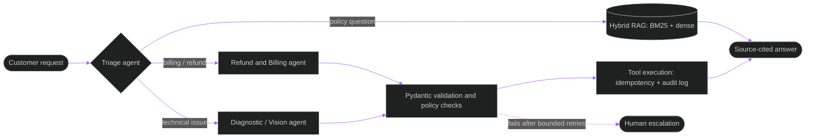

<!--
  THEME: Arcade x AI
  bg #0D1117 | panel #161B22 | border #30363D | text #C9D1D9
  cyan #00E5FF | purple #A855F7 | coin yellow #FFD21E | green #39D353 | pink #FF3D81
  Everything animated here is served by hosted SVG services, so this is the only file you need.
-->

<div align="center">


<br/>


<br/>

<a href="https://github.com/Sumeet0905">
  
</a>

<br/>


<br/><br/>

🍄 ❓ ❓ 🪙 🪙 ❓ 🪙 🏁

</div>

---


```python
class Sumeet:
    name         = "Sumeet Singh"
    class_       = "AI Engineer (Intern)"
    level        = "B.Tech CSE, class of 2027"
    guild        = "Jaypee University of Information Technology, Solan"
    base         = "Ranchi, Jharkhand, India"

    main_quest   = ["LLM-powered applications",
                    "Retrieval pipelines (RAG)",
                    "Agentic workflows"]
    side_quests  = ["Anomaly detection", "Deep learning", "Spiking Neural Networks"]

    guild_roles  = {
        "Sports Secretary": "Sports Club, JUIT",
        "Treasurer":        "Cyber Security Alliance, JUIT",
    }

    motto        = "The LLM proposes. Application code validates and executes."
    hobbies      = ["Basketball", "Cybersecurity", "Team sports"]

    def availability(self):
        return "Full-time, January to June 2027"
```

> **Summary:** B.Tech Computer Science student (expected June 2027) with hands-on Python, machine learning and deep learning experience, seeking an AI Engineer Intern role to build LLM-powered applications, retrieval pipelines and agentic workflows. Experience with Hugging Face Transformers, FastAPI and cloud platforms, plus models validated against expert-labeled NASA data.

---


<div align="center">


<br/><br/>


</div>

<details>
<summary><b>📚 Full skill breakdown</b></summary>
<br/>

| Area | Skills |
|---|---|
| **Programming & Data** | Python, SQL, C++, Pandas, NumPy |
| **Generative AI & NLP** | Hugging Face, Transformers, NLP (NLTK), RAG, LangGraph, Hybrid Retrieval (BM25 + dense), pgvector |
| **APIs, MLOps & Tools** | FastAPI, REST APIs, Pydantic, Git, GitHub, Docker, Linux CLI, Redis, MLflow, Weights & Biases |
| **Machine Learning** | Supervised and Unsupervised Learning, Anomaly Detection, Feature Engineering, Model Evaluation, Neural Networks, CNN, RNN, LSTM, Spiking Neural Networks |
| **Frameworks** | PyTorch, TensorFlow, Keras, scikit-learn, snnTorch, OpenCV |
| **Databases & Cloud** | PostgreSQL, MySQL, AWS, Google Cloud Platform |

</details>

---


<table>
<tr>
<td width="190" align="center">
<b>🏁 CHECKPOINT</b><br/>
June 2026<br/>to<br/>August 2026
</td>
<td>

### Tech Intern: Bharat Space Education Research Center
*Remote*

- 🪙 Built an **unsupervised anomaly detection pipeline** for spacecraft telemetry using Isolation Forest and a Keras autoencoder, training only on normal operating data.
- 🪙 Processed and windowed multi-channel **NASA SMAP/MSL** telemetry. Replaced a fragile Gaussian threshold with a **percentile-based adaptive threshold** for skewed score distributions.
- 🪙 Validated against NASA expert-labeled events: up to **0.98 ROC-AUC** and **100% event-level recall** on validated channels. Documented limitations on contextual anomalies for future iteration.

</td>
</tr>
</table>

---


<br/>

<!-- ============ PROJECT 1 ============ -->
<div align="center">


<br/>

`Python` `FastAPI` `LangGraph` `PostgreSQL/pgvector` `Redis` `Docker` `Pydantic`

**[🔗 View Repository](LINK_TO_REPO)**

</div>

**Multi-Agent Customer Support Platform**

- 🪙 Designed a **deterministic multi-agent workflow** (triage, refund/billing, diagnostic/vision agents) as an explicit state machine with bounded retries, fallbacks and human escalation. The LLM proposes actions and application code validates and executes them.
- 🪙 Built a **RAG pipeline** with section-aware chunking, hybrid BM25 + dense retrieval, reranking and source-cited answers over versioned policy documents.
- 🪙 Implemented **secure tool execution** for state-changing operations: Pydantic schema validation, authorization and policy checks, idempotency keys and audit logging, exposed through FastAPI endpoints.
- 🪙 Defined **evaluation sets** for routing, retrieval and tool use, plus request tracing for latency, cost and failures.



<br/>

<!-- ============ PROJECT 2 ============ -->
<div align="center">


<br/>

`Python` `Keras` `Isolation Forest` `NASA SMAP/MSL`

<a href="https://github.com/Sumeet0905/Satellite-Telemetry-Anomaly-Detection-BSERC-">
  
</a>

</div>

- 🪙 Built an **unsupervised anomaly detection pipeline** using Isolation Forest and a Keras autoencoder, training only on normal operating data.
- 🪙 Replaced a fragile Gaussian threshold with a **percentile-based adaptive threshold** for skewed score distributions.
- 🪙 Validated against NASA expert-labeled events: up to **0.98 ROC-AUC** and **100% event-level recall** on validated channels.

<br/>

<!-- ============ PROJECT 3 ============ -->
<div align="center">


<br/>

`Python` `PyTorch` `snnTorch` `CUDA` &nbsp;|&nbsp; Jan 2026 to May 2026

**[🔗 View Repository](LINK_TO_REPO)**

</div>

**Spike-Based Image Classification using Spiking Neural Networks**

- 🪙 Designed deep SNNs with **LIF and Adaptive LIF neurons** as an energy-efficient alternative to conventional networks.
- 🪙 Benchmarked **8 configurations** on MNIST and CIFAR-10 (70,000+ images).
- 🪙 Achieved **97.92% MNIST test accuracy** with Surrogate Gradient Learning, outperforming R-STDP by up to **47 percentage points**.

<br/>

<!-- ============ PROJECT 4 ============ -->
<div align="center">


<br/>

`Python` `scikit-learn` `GeoPandas` `Matplotlib` &nbsp;|&nbsp; Dec 2025 to Jan 2026

<a href="https://github.com/Sumeet0905/VAYU-M-Visualization-Analysis-of-Yearly-Understanding---Migration-">
  
</a>

</div>

**ML-Based Wildlife Migration Analytics Platform**

- 🪙 Built an end-to-end classification pipeline on **12,000+ georeferenced records** across **457 CMS-listed species** to identify migration patterns.
- 🪙 Trained and compared **6 classifiers** against a common evaluation setup. Random Forest reached **93.8% accuracy**.
- 🪙 Produced GeoPandas visualisations mapping migration hotspots across **7+ Indian states**.

<br/>

<!-- ============ PROJECTS 5 & 6 ============ -->
<div align="center">


<table>
<tr>
<td align="center" width="50%">


<a href="https://github.com/Sumeet0905/Loan_Status_Prediction_Model">
  
</a>

</td>
<td align="center" width="50%">


<a href="https://github.com/Sumeet0905/Diabetes-Risk-Prediction-System">
  
</a>

</td>
</tr>
</table>

📁 Browse every repository on my [repositories tab](https://github.com/Sumeet0905?tab=repositories).

</div>

---


<div align="center">

<table>
<tr>
<td align="center" width="50%">


**Sports Club**<br/>Jaypee University of Information Technology<br/>
🏀 Led and coordinated sports activities and events for the student community.

</td>
<td align="center" width="50%">


**Cyber Security Alliance**<br/>Jaypee University of Information Technology<br/>
🔐 Managed the club's finances and budgeting alongside its cybersecurity initiatives.

</td>
</tr>
</table>

</div>

---


**🎓 Jaypee University of Information Technology**, Solan, Himachal Pradesh
**B.Tech in Computer Science Engineering** | July 2023 to June 2027 (Expected) | CGPA: 7.72 / 10

<div align="center">

</div>

---


<div align="center">


<br/>

<!-- Contribution snake: shows after you add snake.yml and run it once. See setup notes. -->


</div>

---

<div align="center">


<br/>

<a href="mailto:sumeetofficial09@gmail.com"></a>
<a href="YOUR_LINKEDIN_URL"></a>
<a href="https://github.com/Sumeet0905"></a>

<br/><br/>


</div>
